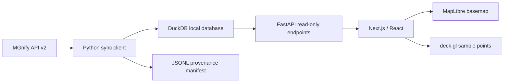

# Microbial Atlas

Microbial Atlas is an interactive, map-first application for exploring publicly available environmental microbiome records. It combines a Next.js interface with a FastAPI API backed by DuckDB and a Python ingestion client for MGnify API v2. Physical sample accessions are counted separately from sequencing runs and analyses; records without coordinates are not placed on the map.

## Current scope

- Dark, responsive MapLibre world map with a deck.gl sample layer. The layer only renders coordinates loaded from the local database.
- Habitat and accession search, sample inspection, study links, and counts from the API.
- Collection timeline derived from reported collection-date years.
- MGnify v2 study/sample discovery with pagination, retries, configurable record limits, coordinate validation, DuckDB persistence, and a JSONL provenance manifest.
- Useful empty states when no local records or analysis profiles have been synchronized.

The optional profile sync parses MGnify V6 amplicon BIOM taxonomy-summary TSVs and calculates observed richness, Shannon, and Simpson metrics within a selected analysis, reference database, and taxonomic rank. Pairwise comparison is restricted to profiles with matching pipeline, reference database, and reported amplicon marker/region. Functional summaries include V6 assembly tables for Pfam, KEGG Orthology, Gene Ontology, GO slim, InterPro, and KEGG module completeness. Source-reported values retain their analysis and database provenance. The current version does not provide cohort-level comparison, PCoA, all MGnify taxonomy outputs, raw-read profiles, per-gene assembly annotations, or integrations with ENA, BioSamples, or GTDB. The atlas represents a subset of MGnify records, not a complete mirror.

No MGnify dataset is bundled with the source repository. Run the ingestion commands below to retrieve public records; available counts depend on the source data and synchronization limits. Local databases, caches, manifests, and parsed data snapshots are excluded from version control.

## Architecture



The sample sync discovers candidate studies using their environmental biome metadata, follows each study's samples relationship, and deduplicates physical samples by accession. Study titles alone do not qualify records. Missing coordinates remain missing; map requests only return valid georeferenced records. MGnify list endpoints use `count`/`items` with `page` and `page_size`; detail responses can contain richer relationship and download metadata. See the [current MGnify API documentation](https://docs.mgnify.org/src/docs/api.html).

Sample metadata, sequencing runs, and processed analyses are distinct entities. The optional analysis sync follows each imported sample's study analysis relationship, retains analyses linked to imported sample accessions, stores run/analysis records separately, and stores download metadata returned by each analysis detail endpoint. The optional profile sync only selects explicitly reported V6 amplicon taxonomy-summary TSV artifacts (not raw sequence files, ASV assignment-only files, or legacy formats). Its parser accepts the BIOM taxonomy-summary header and retains reported counts, taxonomic lineage, database, and analysis provenance. Amplicon V6.2, raw-read V6.0, and assembly V6.0 outputs represent different methods and are not interchangeable measurements.

## Requirements

- Node.js and pnpm
- Python 3.11 or newer (Python 3.14 was used during implementation)
- Network access to MGnify for ingestion and to CARTO/OpenStreetMap tiles for the basemap

No paid API key is required. Map tiles are served by CARTO and attribution is shown in the map.

## Run locally

```bash
pnpm install
python3 -m venv .venv
.venv/bin/pip install -r requirements.txt
pnpm ingest
pnpm api
```

In a second terminal:

```bash
pnpm dev
```

Open http://localhost:3000. The default sync cap is 2,000 newly discovered unique samples per run. To change it, run `pnpm ingest -- --limit 500`. Downloads of raw sequencing files are not performed.

The repository does not include a preloaded database. The first ingestion run needs network access to the public MGnify API and may take several minutes.

To discover new samples from environmentally classified MGnify V6 studies, run `pnpm ingest -- --limit 500 --pipeline V6`. To update run/analysis metadata for the samples already in the local database, run `pnpm ingest -- --analysis-only --analysis-detail-limit 100`. Add `--profiles --profile-limit 20 --functions --function-limit 20` to fetch up to 20 supported taxonomy and 20 assembly annotation summaries. The sync uses URLs reported in analysis details and excludes raw sequence files.

## Storage and API

- DuckDB: `data/atlas.duckdb`
- Source-response cache: `data/raw/mgnify/` (created as ingestion expands)
- Successfully parsed compressed result artifacts: `data/raw/mgnify/artifacts/`
- Ingestion manifest: `data/manifests/mgnify.jsonl`
- `GET /api/v1/health`
- `GET /api/v1/overview`
- `GET /api/v1/samples?limit=200&offset=0&biome=marine&bbox=west,south,east,north`
- `GET /api/v1/search/samples?q=accession-or-study`
- `GET /api/v1/samples/{accession}`
- `GET /api/v1/studies/{accession}`
- `GET /api/v1/timeseries`
- `GET /api/v1/data-sources`
- `GET /api/v1/samples/{accession}/analyses`
- `GET /api/v1/analyses/{accession}/downloads`
- `GET /api/v1/samples/{accession}/taxonomy?limit=100`
- `GET /api/v1/samples/{accession}/functions?limit=100`
- `GET /api/v1/analyses/{accession}/alpha-diversity?reference_database=SILVA-SSU&rank=Genus`
- `GET /api/v1/community-comparison?sample_a=SAMEA…&sample_b=SAMEA…&reference_database=SILVA-SSU&marker_region=16S-V3-V4&rank=Genus`

The backend opens DuckDB read-only for API requests. `ATLAS_DB` can override the database path; `ATLAS_SAMPLE_LIMIT` sets the default sync limit. The frontend API base can be overridden using `NEXT_PUBLIC_API_URL`.

## Develop and check

```bash
pnpm build
pnpm test
.venv/bin/python -m compileall backend
```

## Data provenance and limitations

MGnify is the primary source. The project retains accession links and records the retrieval timestamp, source URL, parser version and ingestion status for imported samples. Sample metadata is submitter/source supplied and may be absent, ambiguous, or imprecise. Coordinates are only mapped when numeric and within valid longitude/latitude bounds; no coordinate precision is inferred. Study biome classification is used as a candidate filter, and environmental inclusion rules are intentionally conservative. This small local dataset is a subset discovered from the live API, not the complete MGnify collection.

## Data and third-party services

MGnify records and analysis outputs remain subject to their source terms and attribution requirements. The MIT license applies to this project's code; it does not relicense third-party data. The application requests basemap tiles from CARTO and displays map attribution. Ingestion contacts the public MGnify API and stores its responses locally. No API key is required.

## License

The code is licensed under the [MIT License](LICENSE).
