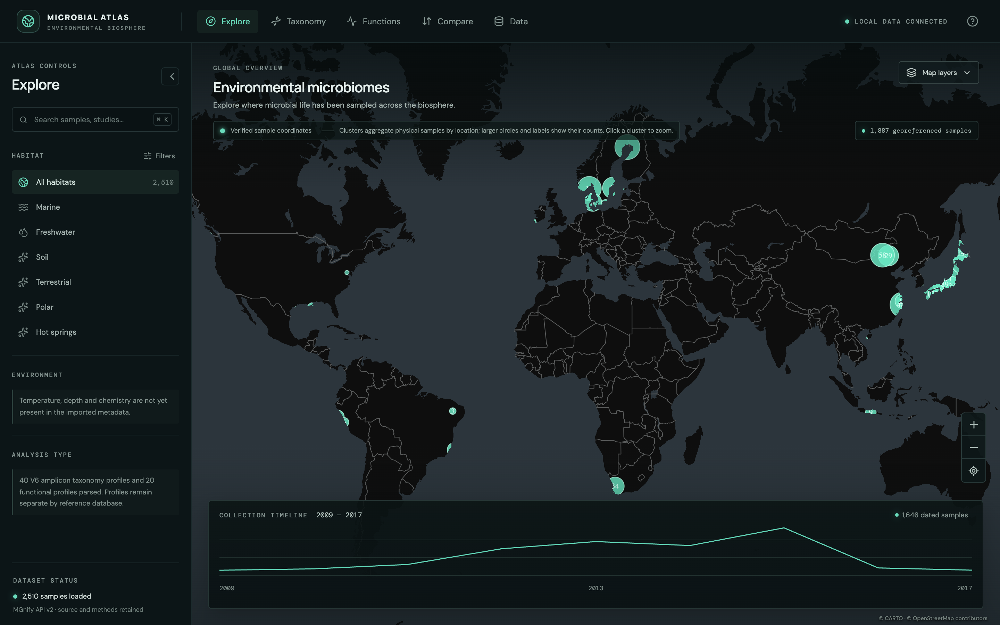
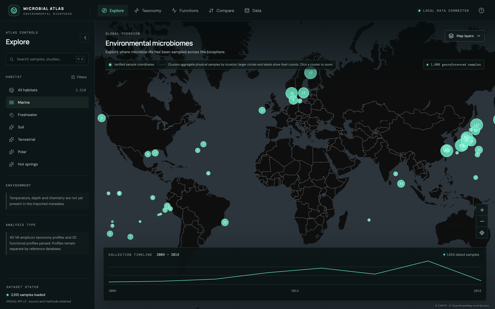
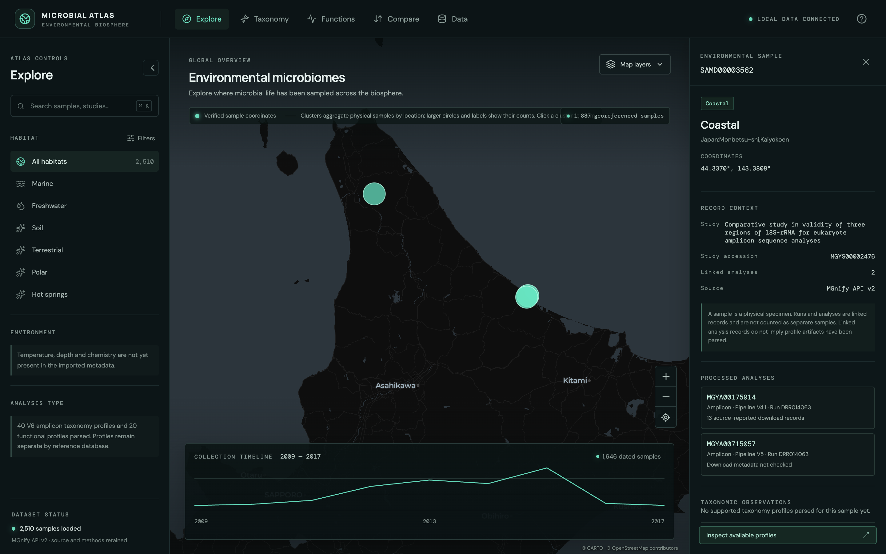
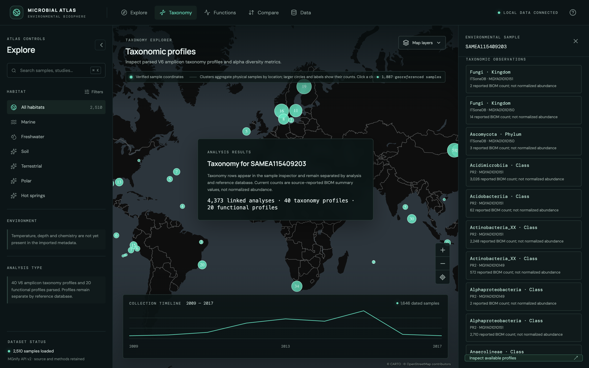
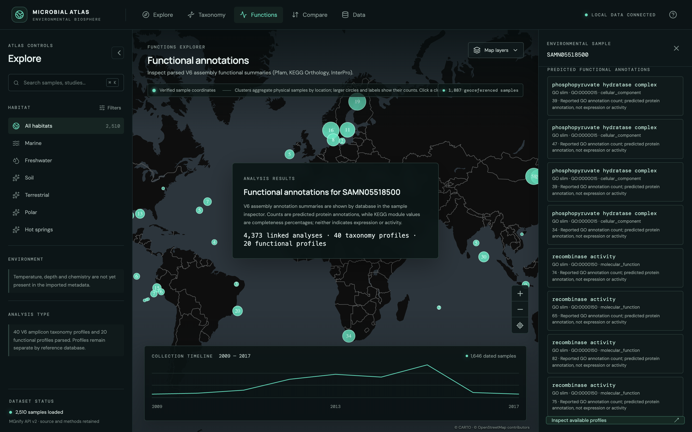
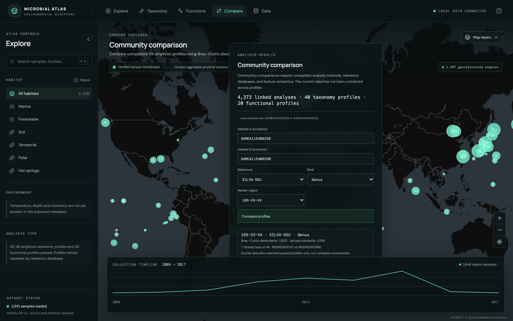
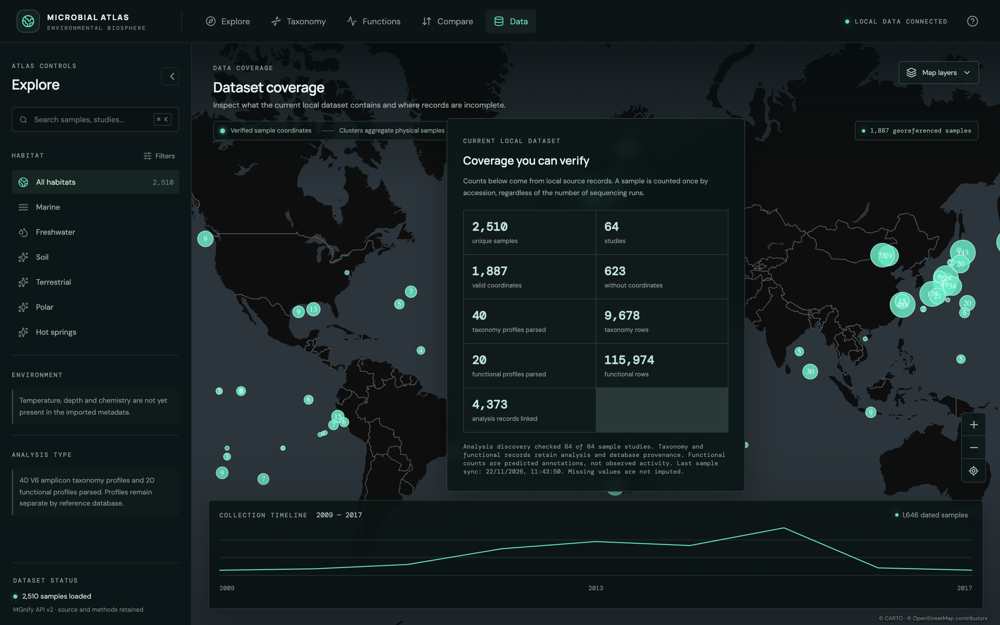
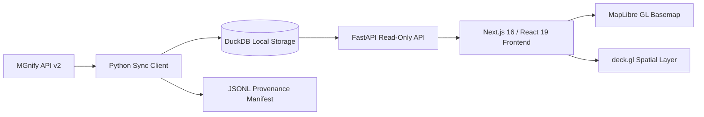

# Microbial Atlas

An interactive, map-first explorer for public environmental microbiome records, provenance, taxonomy, and predicted functional annotations.



Microbial Atlas combines a modern Next.js interface with a FastAPI backend backed by DuckDB and an ingestion pipeline for MGnify API v2. It allows researchers and developers to explore where microbial life has been sampled across the biosphere, inspect study contexts, evaluate taxonomic profiles and alpha diversity metrics, inspect predicted assembly annotations, and compute pairwise community similarity across compatible amplicon profiles.

The platform enforces strict scientific data semantics: **physical sample accessions are deduplicated and counted separately from sequencing runs and analyses**, unlocated samples remain searchable without being plotted on the map, and comparative metrics are restricted to method-compatible profiles.

---

## Key Features

- **Interactive Geospatial Visualization**: Responsive MapLibre dark-matter basemap layered with deck.gl scatterplots and dynamic cluster aggregations that adapt smoothly across zoom levels.
- **Strict Data Provenance**: Complete separation between physical samples, sequencing runs, and processed analyses. Source URLs, checksums, and parser versions are preserved in a JSONL provenance manifest.
- **Habitat & Biome Exploration**: Instant filtering across biomes including Marine, Freshwater, Soil, Terrestrial, Polar, and Geothermal habitats.
- **Collection Timeline**: Dynamic annual collection timeline calculated from source-reported collection dates.
- **Taxonomy & Alpha Diversity**: Parses MGnify V6 amplicon BIOM taxonomy summaries; calculates observed richness, Shannon, and Simpson indices dynamically across taxonomic ranks (Class, Order, Family, Genus, Species) and reference databases (SILVA-SSU, SILVA-LSU, PR2, ITSoneDB).
- **Predicted Functional Annotations**: Ingests and summarizes V6 assembly annotations across Pfam, KEGG Orthology, Gene Ontology, GO slim, InterPro, and KEGG module completeness percentages.
- **Rigorous Community Comparison**: Pairwise community similarity (Bray–Curtis dissimilarity and Jaccard similarity) computed exclusively between profiles sharing identical pipelines, reference databases, and reported amplicon marker regions (e.g. 16S-V3-V4).
- **Verifiable Coverage Audit**: Built-in dataset inspection panel detailing unique samples, georeferenced coordinates, unlocated records, linked analyses, and sync timestamps.

---

## Visual Showcase

### Interactive Map & Habitat Filtering

Filter sample points across biomes and inspect collection timelines derived directly from source records.



### Sample Inspection & Study Context

Inspect georeferenced coordinates, study abstracts, sequencing runs, pipeline versions, and download manifests for any individual specimen.



### Taxonomy & Dynamic Alpha Diversity

Inspect parsed BIOM taxonomy summaries and compute alpha diversity metrics (Observed Richness, Shannon, Simpson) at any taxonomic rank.



### Predicted Functional Annotations

Review parsed V6 assembly annotation summaries across KEGG Orthology, Pfam, Gene Ontology, and KEGG modules with explicit distinction between predicted annotations and measured expression.



### Pairwise Community Comparison

Compare compatible amplicon profiles using Bray–Curtis dissimilarity and Jaccard similarity with automated validation of matching reference databases and marker regions.



### Dataset Coverage & Provenance Audit

Verify dataset completeness, unlocated sample counts, parsed profile totals, and pipeline discovery status directly from local DuckDB storage.



---

## Architecture



- **Frontend**: Next.js 16 (Turbopack), React 19, MapLibre GL, deck.gl, Lucide React, Tailwind-free semantic CSS.
- **Backend**: FastAPI, Uvicorn, DuckDB (read-only query mode), Polars.
- **Ingestion**: Python client with retry logic, rate handling, checksum verification, and JSONL manifest tracking for MGnify API v2.

---

## Requirements

- **Node.js**: v18.0 or newer (tested on Node v22)
- **Package Manager**: `pnpm` (v9+) or `npm`
- **Python**: 3.11 or newer (Python 3.12 / 3.14 compatible)
- **Network**: Required during initial data ingestion and for loading CARTO basemap tiles.

No paid API keys are required. Basemap tiles are served by CARTO under OpenStreetMap attribution.

---

## Quick Start

### 1. Clone & Install Dependencies

```bash
git clone https://github.com/ranajahanzaib/microbial-ecology-map.git
cd microbial-ecology-map

# Install frontend dependencies
pnpm install # or npm install

# Create virtual environment and install backend dependencies
python3 -m venv .venv
.venv/bin/pip install -r requirements.txt
```

### 2. Synchronize Data (Optional if local database exists)

If `data/atlas.duckdb` is not yet populated, run the ingestion client to discover studies and fetch samples from public MGnify records:

```bash
# Discover 500 environmental samples from MGnify V6 studies
pnpm ingest -- --limit 500 --pipeline V6

# Sync analysis metadata and download profiles for local samples
pnpm ingest -- --analysis-only --analysis-detail-limit 100 --profiles --profile-limit 20 --functions --function-limit 20
```

### 3. Start Backend API

```bash
# Start FastAPI server on port 8000 (or specify --port 8010 if 8000 is occupied)
pnpm api
# or directly:
.venv/bin/uvicorn backend.app:app --host 127.0.0.1 --port 8000 --reload
```

Verify backend health at `http://localhost:8000/api/v1/health`.

### 4. Start Frontend Application

In a separate terminal:

```bash
# Set custom API port if needed (default: http://localhost:8000/api/v1)
# echo "NEXT_PUBLIC_API_URL=http://localhost:8000/api/v1" > .env.local

pnpm dev # or npm run dev
```

Open [http://localhost:3000](http://localhost:3000) in your browser.

---

## Data Ingestion CLI

The ingestion CLI (`backend/ingest.py`) provides fine-grained controls for synchronizing public records:

| Option                      | Default             | Description                                                         |
| --------------------------- | ------------------- | ------------------------------------------------------------------- |
| `--limit N`                 | `2000`              | Maximum new unique physical samples to ingest                       |
| `--pipeline P`              | None                | Filter studies by pipeline version (e.g. `V6`)                      |
| `--analysis-only`           | `False`             | Skip sample discovery and only check analyses for existing samples  |
| `--analysis-detail-limit N` | `100`               | Maximum analysis detail endpoints to inspect for download artifacts |
| `--profiles`                | `False`             | Download and parse V6 amplicon BIOM taxonomy summaries              |
| `--profile-limit N`         | `20`                | Cap on taxonomy profile summaries to download and parse             |
| `--functions`               | `False`             | Download and parse V6 assembly annotation tables                    |
| `--function-limit N`        | `20`                | Cap on functional summaries to download and parse                   |
| `--db PATH`                 | `data/atlas.duckdb` | Target DuckDB database file path                                    |

---

## API Reference

The FastAPI service exposes read-only endpoints backed by DuckDB:

| Method | Endpoint                                       | Description                                                             |
| ------ | ---------------------------------------------- | ----------------------------------------------------------------------- |
| `GET`  | `/api/v1/health`                               | Health check and database connection status                             |
| `GET`  | `/api/v1/overview`                             | High-level dataset metrics, counts, and sync timestamps                 |
| `GET`  | `/api/v1/samples`                              | List georeferenced samples with pagination, `biome`, and `bbox` filters |
| `GET`  | `/api/v1/samples/{accession}`                  | Retrieve sample details, study association, and coordinate status       |
| `GET`  | `/api/v1/search/samples`                       | Full-text search across samples, accessions, biomes, and countries      |
| `GET`  | `/api/v1/studies/{accession}`                  | Study metadata, description, and linked sample/run/analysis counts      |
| `GET`  | `/api/v1/timeseries`                           | Annual sample counts grouped by collection date and habitat filter      |
| `GET`  | `/api/v1/samples/{accession}/analyses`         | Processed analyses linked to a physical sample                          |
| `GET`  | `/api/v1/analyses/{accession}/downloads`       | Download artifact manifests for an analysis                             |
| `GET`  | `/api/v1/samples/{accession}/taxonomy`         | Parsed BIOM taxonomy observations and profile metadata                  |
| `GET`  | `/api/v1/samples/{accession}/functions`        | Parsed V6 assembly functional annotations (Pfam, KEGG, GO)              |
| `GET`  | `/api/v1/analyses/{accession}/alpha-diversity` | Observed richness, Shannon index, and Simpson index by rank             |
| `GET`  | `/api/v1/community-comparison`                 | Pairwise Bray–Curtis and Jaccard comparison for compatible profiles     |
| `GET`  | `/api/v1/data-sources`                         | Provenance and source database references                               |

---

## Testing & Quality Assurance

Run the test suite covering API routes, coordinate validation, antimeridian bounding boxes, diversity metrics, comparison constraints, and parser formats:

```bash
# Run unit tests
pnpm test # or npm test

# Compile and validate backend Python modules
.venv/bin/python -m compileall backend

# Validate Next.js production build and TypeScript types
pnpm build # or npm run build
```

---

## Data Provenance & Methodological Boundaries

- **Source Provenance**: Public records originate from EBI MGnify API v2. Ingested records record timestamp, source URL, parser version, and checksum.
- **Coordinates & Spatial Accuracy**: Coordinates are submitter-provided in primary metadata. Missing coordinates are never fabricated or imputed; samples without coordinates remain searchable in the catalog but are not plotted on the map.
- **Taxonomy Semantics**: Ingested counts reflect source-reported BIOM summary values from V6 amplicon pipelines. They represent relative read allocations within each analysis profile, not absolute microbial biomass.
- **Predicted Annotations**: Functional rows (Pfam, KEGG Orthology, InterPro) represent computational predictions from assembled contigs; they do not indicate active gene expression or measured metabolic flux.

---

## Attribution

Third-party data retrieved from MGnify and basemap tiles from CARTO/OpenStreetMap remain subject to their respective terms and attribution requirements.

## License & Custom Work

[](mailto:work@withrana.com) [](https://www.linkedin.com/in/workwithrana)
[](https://www.upwork.com/freelancers/~01bbcf6edb91a8df5f)
[](https://contra.com/ranajahanzaib/)

**License:** MIT, see [LICENSE](LICENSE). Free for personal and commercial use.

**Author:** Rana Jahanzaib

**Need this built for your stack?** Email me what you're working on: work@withrana.com
